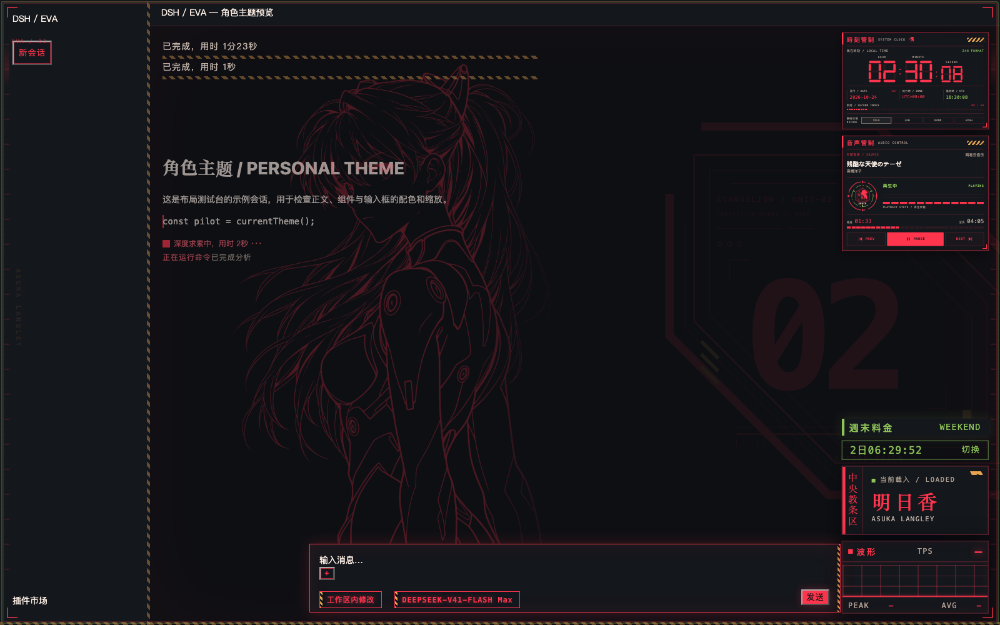
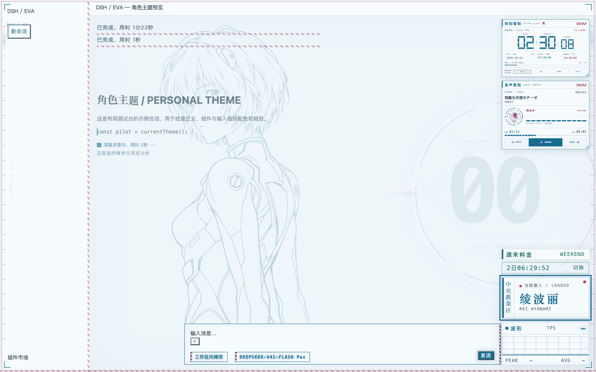
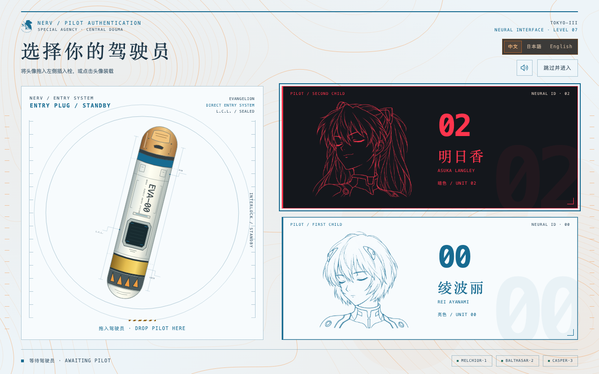

# DSH EVA Theme · EVA 双角色主题插件

`dsh-plugin-eva-theme`

[](https://github.com/seaison/dsh-plugin-eva-theme/actions/workflows/ci.yml)

DSH 的 EVA 双角色皮肤。**暗色载入明日香，亮色载入绫波丽**，覆盖全局界面、输入栏、菜单、设置与主题组件。当前版本 **0.51.2**。

| 模式 | 驾驶员 | 视觉风格 |
| --- | --- | --- |
| 暗色 | 明日香 · ASUKA LANGLEY | 战斗服红、炭黑，橙金与绿色点缀，02 装甲纹样与长双马尾线稿 |
| 亮色 | 绫波丽 · REI AYANAMI | 瓷白、冰蓝，少量红色标记，00 环形纹样与短发线稿 |





截图来自使用模拟会话和音乐数据的布局测试台；实际界面随 DSH 版本、窗口和字体有所差异。

## 安装

从旧名 `dsh-eva-magi-theme` 升级时，先停用旧条目，再安装新名称，避免同时启用两份皮肤。已有显示设置、组件尺寸和启动语言偏好会保留。

1. 下载本仓库 ZIP 并解压，或克隆仓库。保留完整目录，尤其是 `lib/`、`assets/`、`package.json` 和 `cordis.patch.yml`。
2. 在 DSH Desktop 左侧打开「插件」，选择添加插件，在「包名或地址」中填入解压后的项目目录路径，按界面提示安装并启用。
3. 若安装后提示宿主需要重载，按 DSH 提示重启应用。

也可在同一入口使用仓库地址 `https://github.com/seaison/dsh-plugin-eva-theme.git`。安装主题不需要手动运行构建命令；仓库已包含生成后的资源与客户端。

在「设置 → 通用设置 → 外观」选择深色／浅色／跟随系统即可切换角色。启动页选择驾驶员也会保存对应的深浅模式。

已在 **DSH Desktop 2.0.17／2.0.18** 的插件与主题接口上验证，并在官方 **DeepSeek Harness 0.2.1-rc.2（macOS）** 复测两位驾驶员的加载进度。宿主界面升级后，局部装饰可能需要适配；核心颜色通过官方主题令牌覆盖。系统音乐读取和切歌目前支持 **macOS**，其他平台不显示无可用音源的播放器。其余界面和启动功能使用浏览器标准能力，尚未在 Windows／Linux 的 DSH Desktop 中完整验收。

macOS 的窗口拖动依赖宿主拖动区域。**0.51.1 修复了全屏皮肤层导致窗口无法拖动的问题**，已有用户建议升级并按宿主提示重载；驾驶员卡与插入栓仍可正常拖放。[修复与验证说明](docs/macos-window-drag.md)。

## 启动体验

**NERV GIF → 约 3 秒警报 → 黑底打字引导与标题归位 → 选择驾驶员 → 角色语音与装载进度 → 舱门开启 → 聊天界面**。

- GIF 以原尺寸两倍显示、两倍速度循环两轮，总开场时长仍为 3.84 秒。
- 选择前在 GIF 同色黑底上逐字呈现标题，配合短打字音效与两位驾驶员的淡线稿／编号；文字归位到选择页标题，背景柔和显现，可直接跳过，打字时背景音乐保持原音量。0.51.2 同时消除归位完成后的二次淡入闪烁。
- 全屏选择页包含动态橙色等高线、白色 EVA 插入栓、两位驾驶员的闭眼线稿；支持拖放、点击和键盘选择。
- 按住头像触发角色应答，装载后播放对应启动语音；进度与音频真实播放位置同步，完整结束后进入聊天。0.51.2 修复官方客户端前半段停在 0% 后跳到约 60% 的问题，语音、界面和动画时序保持一致。
- 插入栓保持 14° 倾角，表面沿长轴缓慢旋转；装载时归正，系统「减少动态效果」下保持静止。
- 同步完成后双侧舱门开启，进入聊天并播放所选驾驶员的欢迎语音；欢迎音不阻塞输入，取消／跳过不播放。
- 中文／日本語／English 切换启动界面文字并保存偏好，角色语音保持原日语。
- 《EM20#070720》在启动期间播放，角色说话时降音，进入聊天时停止。可用喇叭按钮静音，随时跳过启动。
- 每个浏览器会话自动启动一次；显示设置中的「重新选择驾驶员」可重播。遵循系统「减少动态效果」，切后台会暂停相应动画和语音。



## 组件与设置

点击中央教条区的角色载入标识，打开显示设定。常用尺寸和背景选项直接显示，其他装饰、排版选项可折叠；桌面面板停靠左侧，窄窗口使用底部抽屉。

- **时钟与仪表**：默认倍率均为 1.5、宽约 235px；范围 0.6–5、步长 0.05，支持加减、键盘调整和单项重置。
- **角色背景**：半身线稿贴近输入框上沿，带 02／00 几何纹样，可调强度。
- **音乐播放器**：检测到系统设备播放音乐后出现在时钟下方，提供暂停、上一首和下一首；载入与连接状态使用角色配色。
- **TPS 与计费信息**：显示于中央教条区附近，计费低谷绿色、高峰红色。金额估算仅按插件规则显示，实际以服务方账单为准。
- **角色提示音**：人工操作待审核、已载入主会话任务正常完成时播放对应角色语音。设置中可关闭或分别试听；历史消息、错误、取消和子任务不触发完成提醒。

组件随 DSH 页面缩放，可以覆盖输入栏；背景装饰不拦截输入。卸载或关闭插件会回收样式、资源、监听器和计时器。

## 目录与开发

```text
assets/                 按类型分类的随包媒体、清单与工作线程
  animations/           运行时 GIF
  audio/                角色语音与启动音乐
  images/               透明 PNG 线稿
  svg/                  NERV、警报与插入栓
  source/               原始 GIF，仅开发使用
  workers/              生成的等高线工作线程
lib/                    客户端与宿主接口
  client.js             主题、组件、启动流程
  host-assets.mjs       包内静态资源服务
  host-balance.mjs       余额接口
  host-nowplaying.mjs    macOS 音乐接口
  system-nowplaying.jxa  系统音乐读取脚本
  index.js              插件入口
tests/                  行为、资源、接口与布局回归
tools/                  构建、预览、性能采样与发布工具
docs/                   架构、色板、素材来源、截图和参考稿
```

开发要求 Node.js 22.19+ 或 24+，浏览器测试需要 Chrome／Chromium。零安装依赖。

```sh
npm run build        # 更新生成资源与文档
npm run check        # 静态一致性检查
npm test             # 完整回归
npm run preview      # 本地模拟测试台
npm run perf:boot    # 驾驶员拖放性能采样
npm run release      # 验证、打包，输出 dist/ 和校验值
```

大图片和音频通过同源资源服务加载，地址带内容摘要；等高线计算在 Worker 中执行，不支持时保留同形状的回退。详见 [性能记录](docs/performance.md)、[开发说明](CONTRIBUTING.md)、[GitHub 发布流程](docs/release.md)、[架构](docs/architecture.md) 和 [主题令牌](docs/theme-tokens.md)。

## 素材与许可

代码采用 [MIT](LICENSE)。第三方角色、品牌、音乐和语音素材的来源与许可说明见 [NOTICE](NOTICE.md)、[资源清单](docs/assets.md) 和 [音乐记录](docs/boot-music.md)。维护者已确认《EM20#070720》的再分发授权，公开安装包包含该音轨。代码许可不替代第三方素材的权利说明。

问题反馈请使用 [GitHub Issues](https://github.com/seaison/dsh-plugin-eva-theme/issues)，附 DSH 版本、系统、主题模式、缩放比例和复现步骤；截图前隐藏账号及会话隐私。
